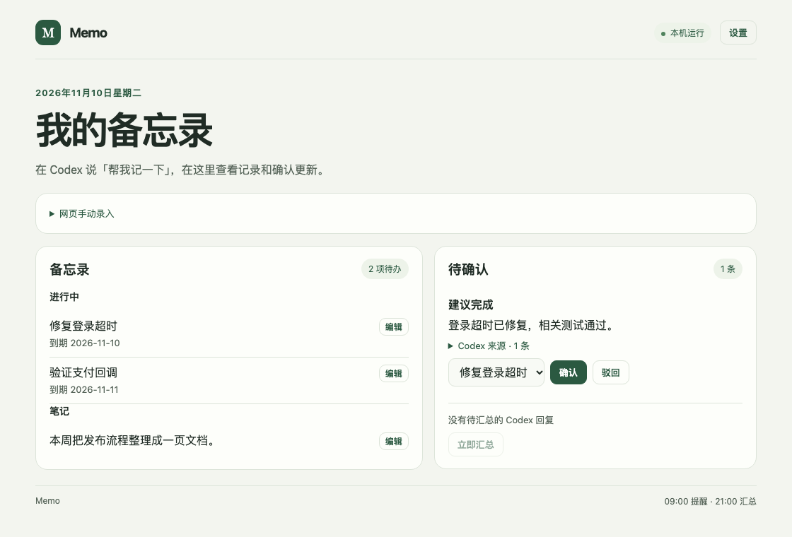

<div align="center">

# Memo

**随手记下待办，把 Codex 的工作进展带回备忘录。**

Python 服务 · Markdown 文件 · Claude Agent SDK · Codex Hooks

[快速开始](#快速开始) · [接入-codex](#接入-codex) · [数据与配置](#数据与配置)



<sub>界面中的记录为示例数据。</sub>

</div>

## 在 Codex 记下一件事

> 帮我记一下：明天验证一下支付回调，登录超时那个已经搞定了。

在已接入的 Codex 项目里发出这句话，Memo 会在后台新增「验证支付回调」，把到期日设为明天，再给已有的「修复登录超时」生成一条完成建议。命中多个待办时，先选中对应的记录再确认。

| 入口 | 处理方式 |
| --- | --- |
| Codex 明确记录请求 | 以「帮我记一下」「帮我记录」或 `memo:` 开头。后台保存新增记录，更新已有待办前等你确认 |
| Codex 普通对话 | 每轮结束时把最后一条回复存入本地收件箱 |
| 本机网页 | 查看和编辑记录、确认更新、管理项目，也可手动录入 |
| 每日汇总 | 默认 21:00 整理已授权的 Codex 回复，生成带来源的待确认建议 |
| 每日提醒 | 默认 09:00 通过 macOS 通知提醒到期或逾期的待办和待确认项 |

## 快速开始

需要 macOS、Python 3.11+、[uv](https://docs.astral.sh/uv/) 和 Anthropic 或 DeepSeek API Key。

```bash
git clone https://github.com/Underdog-RJ/memo.git
cd memo
uv sync --locked
cp .env.example .env
chmod 600 .env
```

使用 Anthropic 时，在 `.env` 中填写 `ANTHROPIC_API_KEY`。使用 DeepSeek 时，填写以下两项。内核仍通过 Claude Agent SDK 调用，默认模型为 `deepseek-flash`。

```dotenv
MEMO_MODEL_PROVIDER=deepseek
DEEPSEEK_API_KEY=
```

[DeepSeek 的 Claude Code 接入文档](https://api-docs.deepseek.com/quick_start/agent_integrations/claude_code/)。

配置完成后启动服务。

```bash
uv run --locked python -m memo.server
```

打开 [http://127.0.0.1:4317](http://127.0.0.1:4317)。在页面的「设置」中可以切换当前服务支持的模型、修改提醒和汇总时间。

关闭网页后，服务仍继续运行。若希望 Mac 登录后自动启动，先停止手动启动的服务，再执行：

```bash
uv run --locked python -m memo.login enable
```

关闭登录启动时执行 `uv run --locked python -m memo.login disable`。首次使用时，可在 macOS 通知设置中允许对应通知。若登录启动在 Desktop 等受保护目录遇到访问限制，可将项目放到普通开发目录，再重新启用登录启动。

## 接入 Codex

1. 打开 Memo 的「设置」，添加本机项目的绝对路径。Worktree 需要单独添加对应目录。
2. 如需自动生成建议，为该项目勾选「允许模型处理」，然后保存。
3. 复制页面里的 Codex Hook 配置，将 `UserPromptSubmit` 和 `Stop` 条目合并到项目的 `.codex/hooks.json`。如果之前装了 Memo 的旧版 Hook，只替换 Memo 自己的条目。
4. 在 Codex 中审阅并信任 Hook。然后发送「帮我记一下：明天验证支付回调」。等后台处理后打开 Memo 查看结果。普通对话可以点「立即汇总」，也可以等每日汇总。

采集从启用后的新对话开始。明确记录请求取用户输入，同一轮的助手回复会跳过重复采集。其他轮次只取最后一条助手回复。处理失败时，内容留在本地收件箱，可在页面重试。详情见 [Codex Hooks](https://learn.chatgpt.com/docs/hooks)。

## 数据与配置

| 位置 | 内容 |
| --- | --- |
| `~/Library/Application Support/Memo/备忘录.md` | 可直接打开或备份的 Markdown 导出 |
| 同目录下的 `state.json` | 记录、设置、待确认建议与汇总进度 |
| 同目录下的 `codex/` | 采集的 Codex 回复片段 |
| 项目内的 `.env` | 模型服务、API Key 和可选的本地配置 |

通过网页编辑记录，应用会同步刷新 Markdown。可在 `.env` 中设置 `MEMO_DATA_DIR` 来指定数据目录，或用 `MEMO_PORT` 修改端口。迁移数据目录后，记得从设置页重新复制 Hook 配置。

网页提交的文本、相关待办和你授权的 Codex 请求及回复片段会交给当前配置的模型服务推理。API Key 由本地服务读取。服务只监听本机回环地址。

## 开发验证

```bash
uv run --locked python -m pytest -q
```

测试用替身模型验证 Codex 请求录入、模糊匹配、人工确认、采集去重、汇总重试、定时补跑、旧版数据兼容和本地请求限制。真实推理需要配置对应的 API Key。

```text
网页输入 ──────────────┐
                      ├─ Claude Agent SDK ── 备忘录 / 待确认建议
Codex Hook ── 本地收件箱 ┘
```
